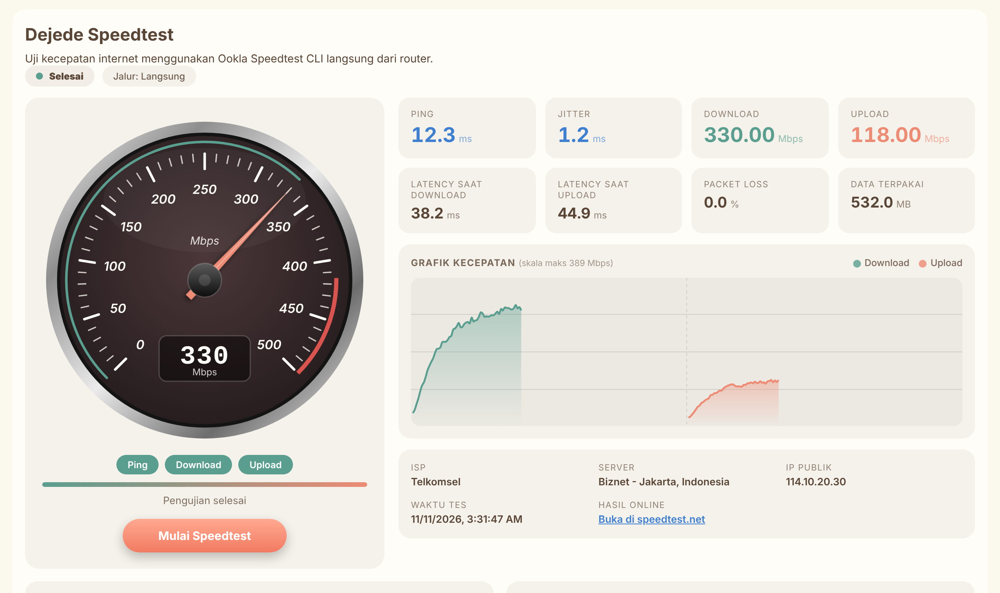
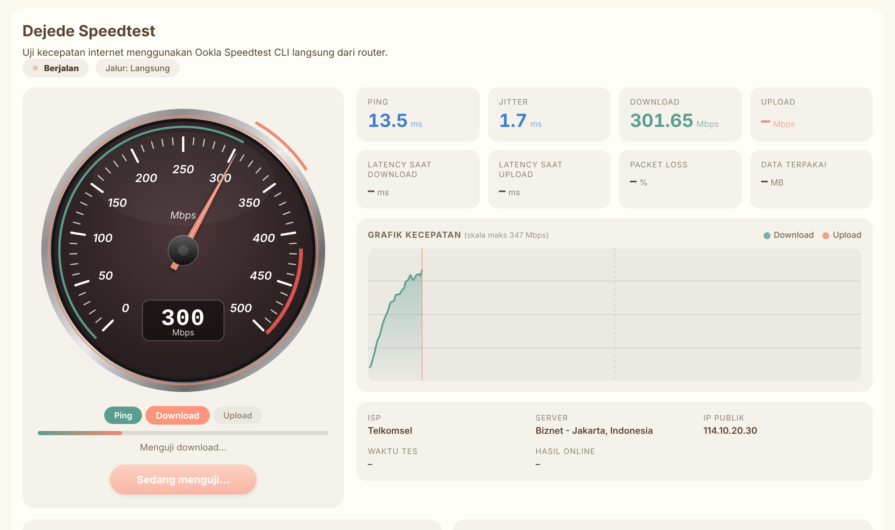
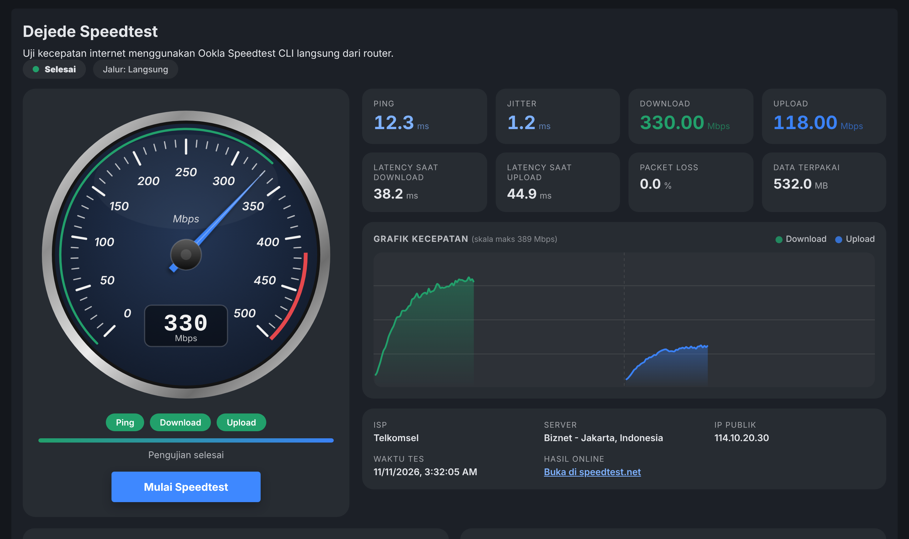
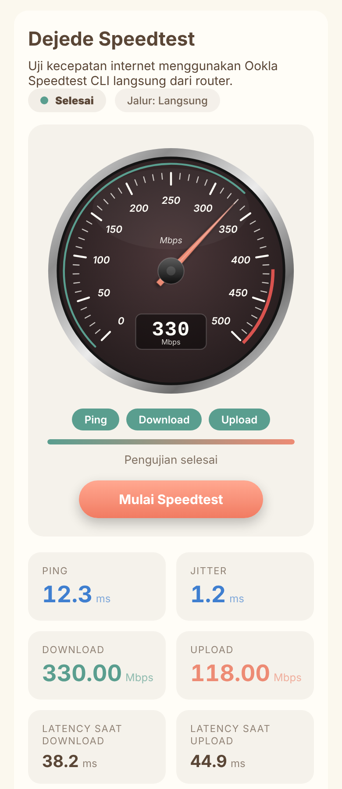
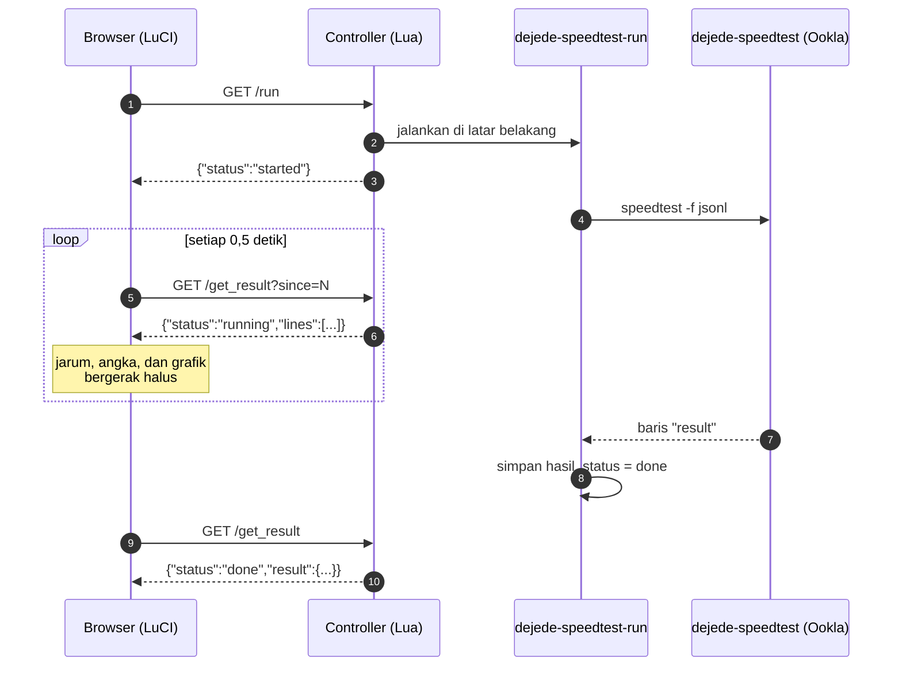
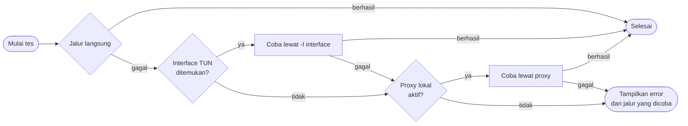

<div align="center">

# Dejede Speedtest for LuCI

**Uji kecepatan internet langsung dari router OpenWrt, dengan speedometer analog, grafik live, dan hasil JSON lengkap.**


-orange?style=flat-square)



</div>

---

## Daftar isi

- [Ringkasan](#ringkasan)
- [Fitur](#fitur)
- [Tampilan](#tampilan)
- [Cara kerja](#cara-kerja)
- [Persyaratan](#persyaratan)
- [Instalasi](#instalasi)
- [Penggunaan](#penggunaan)
- [Konfigurasi](#konfigurasi)
- [Jalur koneksi otomatis](#jalur-koneksi-otomatis)
- [Struktur paket](#struktur-paket)
- [Membangun dari sumber](#membangun-dari-sumber)
- [Endpoint backend](#endpoint-backend)
- [Pemecahan masalah](#pemecahan-masalah)
- [Uninstall](#uninstall)
- [Lisensi dan atribusi](#lisensi-dan-atribusi)

---

## Ringkasan

`luci-app-dejedespeedtest` menambahkan menu **Services → Dejede Speedtest** ke panel LuCI. Satu klik menjalankan **Ookla Speedtest CLI** (binary dinamai `dejede-speedtest`) di router itu sendiri, jadi yang terukur adalah kecepatan koneksi **router**, bukan kecepatan browser atau perangkat Anda.

Pengujian berjalan di latar belakang dan hasilnya ditarik lewat AJAX. Halaman tidak di-reload dan browser tidak timeout, bahkan pada koneksi yang lambat.

> **Kapan berguna?** Memeriksa kecepatan WAN yang sebenarnya tanpa terpengaruh Wi-Fi, membandingkan beberapa jalur (langsung, TUN, proxy), atau memantau kualitas koneksi lewat riwayat dan hasil JSON.

## Fitur

| Area | Rincian |
|---|---|
| **Speedometer analog** | Dial bergaya instrumen: bezel krom, tick dan angka miring, jarum, zona akhir berwarna, serta display digital. Skala menyesuaikan otomatis (100, 200, 500, 1000, dan seterusnya). |
| **Animasi halus** | Jarum, angka, dan grafik bergerak per frame menuju nilai terbaru, tanpa lompatan. Menghormati pengaturan sistem *kurangi gerakan*. |
| **Mengikuti tema LuCI** | Warna aksen, hijau, dan merah dibaca dari tombol tema yang sedang aktif. Berfungsi di tema terang maupun gelap, tanpa konfigurasi. |
| **Lebar penuh** | Memakai seluruh lebar area konten LuCI. Di layar sempit tata letak berubah menjadi satu kolom. |
| **Hasil lengkap** | Ping, jitter, download, upload, latency saat download dan upload, packet loss, data terpakai, ISP, server, IP publik, dan tautan hasil di speedtest.net. |
| **Grafik live** | Kurva download dan upload yang tumbuh selama tes, lengkap dengan area gradient. |
| **Tahapan dan progress** | Penanda Ping, Download, Upload, dan progress bar keseluruhan. |
| **Jalur koneksi otomatis** | Mencoba jalur langsung, lalu interface TUN, lalu proxy lokal, jika jalur sebelumnya tidak bisa menjangkau Ookla. Berguna untuk router dengan OpenClash atau sejenisnya. |
| **Riwayat dan ekspor** | 20 tes terakhir (tersimpan di browser), tombol **Salin** dan **Unduh .json**. |
| **Ringan di router** | Polling 2 kali per detik hanya membaca file di `/tmp`, dan pengecekan proses memakai syscall tanpa menjalankan proses baru. |

## Tampilan

Tangkapan layar diambil pada tema contoh. Pada router Anda, warna otomatis mengikuti tema LuCI yang aktif.

<table>
  <tr>
    <td width="50%"><b>Saat tes berjalan</b><br>Jarum hidup, tahapan menyala bergantian, grafik tumbuh.<br></td>
    <td width="50%"><b>Tema gelap</b><br>Aksen dan warna dial menyesuaikan tema.<br></td>
  </tr>
  <tr>
    <td colspan="2" align="center"><b>Layar ponsel</b><br></td>
  </tr>
</table>

## Cara kerja



1. **Browser** memanggil `/run`. Controller menjalankan skrip pembungkus `dejede-speedtest-run` di latar belakang dan langsung membalas, sehingga request tidak menggantung.
2. **Pembungkus** menjalankan binary Ookla dengan keluaran `jsonl` (satu baris JSON per kejadian) dan menulisnya ke `/tmp`.
3. **Browser** mengambil baris baru lewat `/get_result?since=N`, hanya yang belum pernah diterima, lalu menggerakkan dial dan grafik.
4. Setelah baris `result` muncul, status menjadi `done` dan hasil akhir ditampilkan sebagai JSON.

## Persyaratan

| Komponen | Keterangan |
|---|---|
| Router | OpenWrt dengan **opkg** dan **LuCI berbasis Lua/CBI** |
| Dependensi | `libc`, `zlib`, `wget`, `luci-base`, `luci-compat` |
| Arsitektur | `aarch64_*`, `arm_*`, `x86_64`, `i386` (Ookla tidak menyediakan binary **mips/mipsel**) |
| Jaringan | Router harus bisa menjangkau server Ookla (HTTPS) |
| Browser | Browser modern (mendukung `fetch`, SVG, dan CSS variable) |

> **Catatan `luci-compat`:** pada OpenWrt 21.02 ke atas, LuCI Lua/CBI membutuhkan paket `luci-compat`. Untuk OpenWrt 19.07 atau 18.06, hapus `luci-compat` dari `PKG_DEPENDS` di `build-ipk.sh` sebelum membangun.

## Instalasi

**1. Cek nama arsitektur router**

```sh
opkg print-architecture
```

Ambil nama arsitektur dengan prioritas tertinggi selain `all` dan `noarch`, misalnya `aarch64_generic`. Paket harus dibangun dengan nama yang sama, kalau tidak opkg akan menolak dengan pesan *incompatible with the architectures configured*.

**2. Salin dan pasang paket**

```sh
scp luci-app-dejedespeedtest_1.2.0-6_aarch64_generic.ipk root@192.168.1.1:/tmp/
ssh root@192.168.1.1
opkg install /tmp/luci-app-dejedespeedtest_1.2.0-6_aarch64_generic.ipk
rm -rf /tmp/luci-*
```

Jika opkg meminta dependensi: `opkg update && opkg install luci-compat`.

**3. Muat ulang LuCI**

Buka kembali halaman LuCI dengan <kbd>Ctrl</kbd>+<kbd>F5</kbd>. Menu ada di **Services → Dejede Speedtest**.

## Penggunaan

1. Buka **Services → Dejede Speedtest**.
2. Klik **Mulai Speedtest**.
3. Pantau dial, grafik, dan tahapan. Tes biasanya selesai dalam sekitar 30 detik.
4. Lihat hasil di kartu, riwayat, atau kotak **Hasil JSON** (tersedia tombol **Salin** dan **Unduh .json**).

Halaman ini tidak memiliki tombol Save atau Apply, karena tidak ada pengaturan yang disimpan dari UI. Pengaturan lanjutan dilakukan lewat UCI (lihat berikut).

## Konfigurasi

File konfigurasi: `/etc/config/dejedespeedtest`

| Opsi | Bawaan | Fungsi |
|---|---|---|
| `method` | `auto` | Cara menjangkau Ookla: `auto`, `direct`, `interface`, atau `proxy` |
| `interface` | *(kosong)* | Nama interface untuk `-I`, mis. `utun`. Dipakai oleh `method=interface`, dan sebagai kandidat pertama pada mode `auto` |
| `proxy` | *(kosong)* | URL proxy, mis. `http://127.0.0.1:7890`. Jika kosong pada `method=proxy`, dipakai `http://127.0.0.1:7890` |
| `server_id` | *(kosong)* | ID server Ookla tertentu. Kosong berarti server terdekat otomatis |
| `timeout` | `120` | Batas waktu maksimum satu percobaan (detik) |

Contoh:

```sh
uci set dejedespeedtest.main.method='auto'
uci set dejedespeedtest.main.interface='utun'
uci set dejedespeedtest.main.proxy='http://127.0.0.1:7890'
uci set dejedespeedtest.main.server_id='12345'
uci set dejedespeedtest.main.timeout='120'
uci commit dejedespeedtest
```

Mencari ID server terdekat:

```sh
/usr/bin/dejede-speedtest --accept-license --accept-gdpr -L
```

## Jalur koneksi otomatis

Pada mode `auto`, pembungkus mencoba jalur satu per satu sampai ada yang berhasil. Jalur dianggap gagal jika Ookla tidak memberi respons apa pun selama 25 detik, atau selesai tanpa hasil.



| Jalur | Cara | Catatan |
|---|---|---|
| Langsung | Tanpa opsi tambahan | Dicoba pertama |
| Interface TUN | `-I <interface>` | Memakai opsi `interface` bila diisi. Jika kosong, mencari `utun`, `tun0`, `tun1`, `Meta`, atau `clash-tun` yang ada di router |
| Proxy lokal | Variabel `https_proxy`, `http_proxy`, dan `ALL_PROXY` | Memakai opsi `proxy` bila diisi. Jika kosong, `http://127.0.0.1:7890` dicoba hanya bila port tersebut sedang listening |

Jalur yang akhirnya dipakai ditampilkan sebagai label **Jalur:** di bagian atas halaman. Perlu diingat, pengukuran lewat TUN atau proxy mencerminkan kecepatan **lewat tunnel tersebut**, bukan kecepatan mentah koneksi WAN.

## Struktur paket

Isi paket setelah terpasang:

```text
/etc/config/dejedespeedtest                               konfigurasi UCI (dipertahankan saat upgrade)
/usr/bin/dejede-speedtest                                 binary Ookla Speedtest CLI
/usr/bin/dejede-speedtest-run                             pembungkus: jalur otomatis, timeout, hasil ke /tmp
/usr/lib/lua/luci/controller/dejedespeedtest.lua          menu dan endpoint /run, /get_result
/usr/lib/lua/luci/model/cbi/dejedespeedtest/main_config.lua   model CBI (tanpa tombol Save/Apply)
/usr/lib/lua/luci/view/dejedespeedtest/speedtest.htm      tampilan: dial, grafik, riwayat, AJAX
```

Metadata paket (`CONTROL/`): `control`, `conffiles`, `postinst` (memberi `chmod +x` pada kedua binary dan membersihkan cache LuCI), serta `postrm`.

File sementara yang dibuat saat tes berjalan, semuanya di `/tmp`:

| File | Isi |
|---|---|
| `dejedespeedtest.state` | `running`, `done`, atau `error` |
| `dejedespeedtest.jsonl` | Keluaran progres Ookla, satu baris JSON per kejadian |
| `dejedespeedtest.json` | Hasil akhir (atau pesan error dalam bentuk JSON) |
| `dejedespeedtest.method` | Nama jalur yang sedang atau terakhir dipakai |
| `dejedespeedtest.err`, `dejedespeedtest.log` | Keluaran error binary dan pembungkus, berguna untuk diagnosis |
| `dejedespeedtest.pid` | PID pembungkus yang sedang berjalan |

## Membangun dari sumber

Seluruh paket dibangun oleh satu skrip, `build-ipk.sh`, yang membuat struktur folder, mengunduh binary Ookla, menyusun semua file, lalu menghasilkan `.ipk`.

```sh
chmod +x build-ipk.sh

./build-ipk.sh                          # aarch64_generic (bawaan)
./build-ipk.sh aarch64_cortex-a53       # arsitektur lain
./build-ipk.sh x86_64
```

Hasilnya ada di `output_ipk/luci-app-dejedespeedtest_<versi>_<arsitektur>.ipk`.

**Variabel opsional**

| Variabel | Fungsi |
|---|---|
| `SPEEDTEST_TGZ=/path/ookla.tgz` | Memakai tarball Ookla yang sudah ada, tanpa mengunduh |
| `PKG_VERSION=1.2.0-7` | Mengganti versi paket |

**Pemetaan arsitektur** (nama OpenWrt ke binary Ookla)

| Arsitektur OpenWrt | Binary Ookla |
|---|---|
| `aarch64*` | `aarch64` |
| `x86_64` | `x86_64` |
| `i386*` | `i386` |
| `arm_cortex-a7*`, `a9*`, `a15*`, `arm_arm1176*`, `arm_mpcore*` | `armhf` |
| `arm_*` lainnya | `armel` |
| `mips`, `mipsel` | tidak didukung |

Binary diunduh dari `https://install.speedtest.net/app/cli/ookla-speedtest-1.2.0-linux-<arsitektur>.tgz`. Jika jaringan Anda memblokir alamat itu, unduh tarball secara manual lalu jalankan dengan `SPEEDTEST_TGZ`. Skrip memakai `opkg-build` bila tersedia, dan jika tidak, merakit `.ipk` sendiri dengan `tar`.

## Endpoint backend

Semua endpoint berada di bawah `/cgi-bin/luci/admin/services/dejedespeedtest/` dan membutuhkan sesi login LuCI.

| Endpoint | Fungsi |
|---|---|
| `run` | Memulai tes di latar belakang. Membalas `{"status":"started"}`, atau `{"status":"running"}` bila tes sedang berjalan |
| `get_result?since=N` | Mengembalikan status dan baris progres baru sejak indeks `N` (maksimum 300 baris per respons) |

Nilai `status` pada `get_result`:

| Status | Isi respons |
|---|---|
| `idle` | Tidak ada tes |
| `running` | `method`, `total`, `lines` (baris baru), dan `reset` bila indeks tidak valid |
| `done` | `method` dan `result` (objek hasil Ookla) |
| `error` | `method` dan `result` berisi `error`, `detail`, dan `attempts` |

## Pemecahan masalah

<details>
<summary><b>opkg menolak: "incompatible with the architectures configured"</b></summary>

Label arsitektur di dalam `.ipk` tidak sama dengan milik router. Jalankan `opkg print-architecture`, lalu bangun ulang dengan nama arsitektur yang sama, misalnya `./build-ipk.sh aarch64_generic`.
</details>

<details>
<summary><b>Menu tidak muncul setelah instalasi</b></summary>

Pastikan `luci-compat` terpasang (`opkg install luci-compat`), bersihkan cache dengan `rm -rf /tmp/luci-*`, lalu muat ulang halaman dengan <kbd>Ctrl</kbd>+<kbd>F5</kbd>.
</details>

<details>
<summary><b>Pesan "Configuration - Timeout was reached" atau "Could not retrieve or read configuration"</b></summary>

Pesan ini datang dari binary Ookla: router tidak berhasil mengunduh konfigurasi dari server Ookla. Penyebabnya hampir selalu jalur jaringan, bukan paket. Periksa:

```sh
nslookup www.speedtest.net
ping -c 3 8.8.8.8
wget -T 10 -S --spider https://www.speedtest.net
```

Penyebab umum: DNS bermasalah, IPv6 atau NAT64 yang tidak berfungsi untuk trafik dari router, atau trafik router sendiri yang tertahan oleh proxy atau TUN (mis. OpenClash). Mode `auto` sudah mencoba jalur TUN dan proxy; Anda juga bisa menguji manual:

```sh
/usr/bin/dejede-speedtest --accept-license --accept-gdpr -I utun
https_proxy=http://127.0.0.1:7890 /usr/bin/dejede-speedtest --accept-license --accept-gdpr
```

Jika salah satunya berhasil, tetapkan lewat UCI (`method`, `interface`, atau `proxy`).
</details>

<details>
<summary><b>Pesan "Proses berhenti tak terduga"</b></summary>

Pembungkus berhenti sebelum menghasilkan hasil. Lihat detailnya:

```sh
cat /tmp/dejedespeedtest.log /tmp/dejedespeedtest.err
/usr/bin/dejede-speedtest --version
```

Jika `--version` gagal dengan *not found* atau *not executable*, binary tidak cocok dengan arsitektur router. Bangun ulang dengan arsitektur yang benar.
</details>

<details>
<summary><b>Pengunduhan binary gagal saat membangun (HTTP 403)</b></summary>

Jaringan tempat Anda membangun memblokir `install.speedtest.net`. Unduh tarball dari komputer lain, lalu: `SPEEDTEST_TGZ=/path/ookla-speedtest-1.2.0-linux-aarch64.tgz ./build-ipk.sh aarch64_generic`.
</details>

<details>
<summary><b>Warna tampilan tidak sesuai tema</b></summary>

Warna dibaca dari tombol bawaan LuCI (kelas `cbi-button-action`, `cbi-button-save`, `cbi-button-negative` atau `cbi-button-reset`). Jika tema Anda tidak mewarnai kelas tersebut, dipakai warna cadangan. Muat ulang halaman setelah berganti tema.
</details>

## Uninstall

```sh
opkg remove luci-app-dejedespeedtest
```

File konfigurasi `/etc/config/dejedespeedtest` dipertahankan oleh opkg bila sudah pernah diubah. Hapus manual bila tidak diperlukan. File sementara di `/tmp` dibersihkan otomatis.

## Lisensi dan atribusi

- **Ookla Speedtest CLI** adalah perangkat lunak milik Ookla dan tunduk pada ketentuan Ookla (EULA, Terms of Use, dan Privacy Policy). Pembungkus menjalankan binary dengan `--accept-license --accept-gdpr` agar tes bisa berjalan tanpa interaksi, artinya dengan memakai paket ini Anda menyetujui ketentuan tersebut. Baca ketentuannya di [speedtest.net/about](https://www.speedtest.net/about) dan halaman [Speedtest CLI](https://www.speedtest.net/apps/cli) sebelum memakainya, terutama untuk penggunaan di luar keperluan pribadi.
- Kode antarmuka, controller, dan skrip pembungkus pada paket ini adalah bagian dari proyek **Dejede Speedtest**. Tentukan lisensi sesuai kebutuhan Anda sebelum mendistribusikannya.
- Paket ini tidak berafiliasi dengan Ookla maupun proyek OpenWrt.
